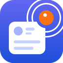

<p align="center"></p>

# PostPing

Chrome extension theo dõi **bài viết mới trong Facebook Group**. Mỗi tab theo dõi một group riêng, có lọc từ khóa, tần suất kiểm tra tùy chỉnh và log hiển thị kiểu terminal trong side panel.

## Tính năng

- **Chạy độc lập theo tab**: bấm icon ở tab nào thì side panel mở cho tab đó. Mỗi tab có panel, trạng thái và log riêng, không ảnh hưởng tab khác.
- **Lọc từ khóa**: nhiều từ khóa cách nhau bằng dấu phẩy, khớp **một** trong các từ là được ghi log. Không phân biệt hoa/thường và dấu tiếng Việt ("can ho" khớp "Căn hộ"). Để trống thì ghi mọi bài mới.
- **Tần suất kiểm tra** tính bằng phút (tối thiểu 1 phút).
- **Log kiểu terminal**: giờ phát hiện, người đăng, nội dung (bấm để mở rộng), từ khóa khớp và link **Mở bài ↗**. Có nút **Xóa log**.
- **Lưu cấu hình** (từ khóa, tần suất) theo từng group. Mở lại group đó thì tự điền lại.
- Log **không lưu lâu dài**: vẫn còn khi đóng/mở lại panel, nhưng mất khi đóng tab hoặc tắt trình duyệt.

## Cài đặt

1. Tải code về: `git clone https://github.com/TranHuyHoang00/extension_post_ping.git`
2. Mở `chrome://extensions`, bật **Developer mode** (góc trên bên phải).
3. Bấm **Load unpacked** và chọn thư mục `extension_post_ping`.
4. Ghim icon PostPing lên thanh công cụ cho tiện.

> Sau khi cập nhật code và bấm reload extension, hãy **tải lại các tab Facebook** đang mở.

## Cách dùng

1. Mở một Facebook Group (đã đăng nhập).
2. Bấm icon **PostPing**, side panel hiện ra bên phải.
3. Nhập từ khóa (hoặc để trống), chọn số phút, bấm **Bắt đầu**.
4. Lần đầu, extension chuyển group sang chế độ **Bài viết mới** và ghi nhận các bài đang có (không log). Từ lần kiểm tra sau, bài mới khớp từ khóa sẽ hiện trong log.
5. Muốn theo dõi group khác, mở tab mới với group đó và lặp lại. Nút **Kiểm tra ngay** để chạy một lần không chờ đến chu kỳ.

## Cách hoạt động

```
alarm (mỗi N phút) ──► background reload tab: /groups/<id>/?sorting_setting=CHRONOLOGICAL
                                    │
content.js (trang tải xong) ◄───────┘  hỏi "tab này có đang theo dõi không?"
   │ đợi feed, cuộn thêm vài lần, đọc bài (id, người đăng, nội dung, link)
   ▼
background: so với danh sách bài đã thấy ─► lọc từ khóa ─► ghi log ─► side panel cập nhật
```

| File | Vai trò |
| --- | --- |
| `manifest.json` | Khai báo extension (Manifest V3) |
| `background.js` | Quản lý trạng thái từng tab, alarm, so sánh bài mới, lọc từ khóa |
| `content.js` | Đọc bài viết trên feed của group |
| `sidepanel.html/.css/.js` | Giao diện nhập liệu và terminal log |
| `icons/` | Icon 16/32/48/128 px (tạo bằng `tools/make_icons.py`) |

## Lưu ý

- **Tab phải luôn mở** (có thể để ở nền). Extension sẽ reload tab đó theo chu kỳ, nên tránh vừa gõ bình luận vừa để nó chạy.
- Tab ở nền thường chỉ tải vài bài đầu tiên. Với group rất sôi động, hãy đặt tần suất ngắn để không bỏ sót.
- Đừng đặt tần suất quá dày khi mở nhiều tab cùng lúc, Facebook có thể yêu cầu xác minh hoặc tạm chặn tài khoản.
- Facebook thay đổi giao diện thường xuyên. Nếu log báo "Không tìm thấy bài nào trên feed" liên tục, có thể cần cập nhật bộ chọn trong `content.js`.
